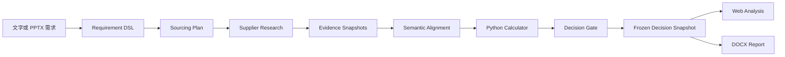

# Procurement Sourcing Agent

面向采购团队的公开寻源研究 Agent。系统把文字或 PPTX 需求转换为可核验约束，从公开网页发现供应商与具体型号，按统一口径比对规格和价格，并输出带来源快照的冻结分析、网页结果和 DOCX 报告。

- **在线演示**：<https://procurement-sourcing-agent.com>
- **技术手册**：[`docs/technical_documentation.md`](docs/technical_documentation.md)
- **许可证**：MIT

## 核心能力

- **需求驱动**：接收文字、PPTX 或两者组合。历史采购 XLSX 可选。
- **公开寻源**：使用 Tavily Search 发现来源，使用 Tavily Extract 读取页面正文。
- **证据可追溯**：每项外部声明引用页面快照、URL、内容哈希和逐字引文。
- **规格核验**：模型负责语义对齐，纯 Python 计算器负责单位换算、数值比较和硬约束聚合。
- **价格可比性**：区分计划预算、历史成交价、公开参考价和正式报价。口径不一致时不做比较。
- **版本化输出**：网页和 DOCX 读取同一决策快照。历史报告不会随供应商情报更新而变化。
- **数据隔离**：项目、访客会话、公开情报和模拟历史供应商使用独立作用域。

`UNKNOWN` 表示现有证据不足以判断，不等于不合格。系统提供初步寻源和询价建议，不执行自动询价、供应商准入、定标或下单。

## 工作流程



公开网页摘要是发现线索，不是证据。只有抓取后的页面正文可以支持声明。

## 系统架构

| 层 | 技术与职责 |
| --- | --- |
| 前端 | React、Vite。提供需求输入、运行进度、候选分析、证据查看和报告下载。 |
| API 网关 | TypeScript、Cloudflare Workers。负责会话、归属、限流、任务预约和公开 API。 |
| 编排 | Cloudflare Workflows。持久化长任务阶段、重试和终态。 |
| Agent 服务 | Python、FastAPI、Deep Agents。执行需求编译、公开寻源、规格核验、决策和报告生成。 |
| 模型 | OpenAI 兼容接口。用于语义提取、属性对齐和结构化建议。 |
| 搜索 | Tavily Search 与 Extract。 |
| 业务数据 | Cloudflare D1。保存项目、需求、情报、证据元数据、核验、决策和快照。 |
| 文件 | 私有 Cloudflare R2。保存上传文件、网页正文和 DOCX 报告。 |
| 追踪 | LangSmith。保存模型、工具和子任务轨迹。 |

## 仓库结构

```text
src/procurement_agent/   Python 领域模型、服务、Agent、API 和报告
cloudflare/gateway/      Worker 网关、Workflow 和 D1 migrations
frontend/                React 与 Vite 前端
tests/                   Python、Worker 和前端测试
scripts/                 本地、远程和云端验收脚本
docs/                    技术手册、契约、验收和数据合规说明
```

## 本地开发

### 前置条件

- Python 3.11 与 [`uv`](https://docs.astral.sh/uv/)
- Node.js 与 npm
- OpenAI 兼容模型端点
- Tavily API key

### 安装依赖

```bash
uv sync --python 3.11
npm ci
npm --prefix frontend ci
cp .env.example .env
```

在 `.env` 中填写模型和 Tavily 凭证。不要提交真实密钥。

### 启动前端

```bash
npm --prefix frontend run dev
```

Vite 开发服务器默认代理到已部署的网关。连接其他部署时，在 `frontend/.env.local` 中设置 `API_PROXY_TARGET`。

### 运行检查

```bash
uv run --python 3.11 python -m pytest -q
npm run check
npm --prefix frontend test
npm --prefix frontend run e2e
```

Playwright 首次运行前需要安装浏览器：

```bash
cd frontend && npx playwright install chromium
```

## 部署

`main` 分支的更新由 Cloudflare Workers Builds 构建并发布。手动发布时执行：

```bash
npm --prefix frontend ci
VITE_GUEST_SESSION=1 npm --prefix frontend run build
npx wrangler d1 migrations apply DB --remote
npx wrangler deploy
```

云端密钥通过 Wrangler Secret 配置，不写入 `wrangler.jsonc`。主要密钥包括：

- `GENESIS_BASE_URL`
- `GENESIS_ACCESS_TOKEN`
- `GENESIS_MODEL_ID`
- `TAVILY_API_KEY`
- `GUEST_SESSION_SECRET`
- `DEMO_ACCESS_TOKEN`
- `INTERNAL_GATEWAY_TOKEN`

发布新容器镜像时需要更新 `CONTAINER_INSTANCE_NAME`。运行中的 Container 会继续使用启动时的镜像。

## 文档

| 文档 | 内容 |
| --- | --- |
| [`docs/technical_documentation.md`](docs/technical_documentation.md) | 产品契约、架构、判定语义、接口、安全、部署和限制。 |
| [`docs/requirement_dsl.md`](docs/requirement_dsl.md) | Requirement DSL 字段、算子和使用约束。 |
| [`docs/data_model.md`](docs/data_model.md) | 领域对象、D1 表和 R2 对象。 |
| [`docs/m4/data_compliance.md`](docs/m4/data_compliance.md) | 数据来源、存储、访客隔离和合规边界。 |
| [`docs/acceptance_commands.md`](docs/acceptance_commands.md) | 本地与云端验收命令。 |

## License

[MIT](LICENSE)
