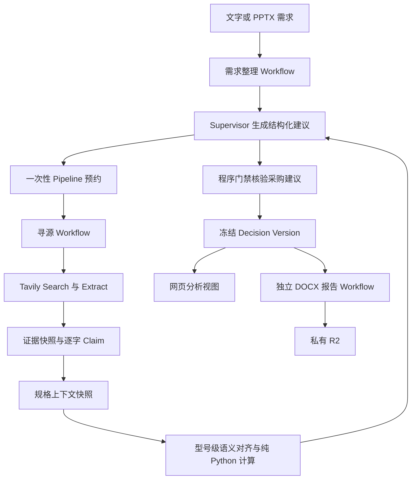

# 采购智能寻源比价助理技术手册

本手册说明系统的产品边界、运行架构、判定语义、数据契约、公开接口、安全措施、质量证据、部署方法和演示流程。评委、接手开发人员、测试人员和运维人员可从本文件核对系统“做了什么、为什么这样做、如何复现、哪些结论尚未得到验证”。

本文采用系统参考手册模式。每个流程都直接描述当前行为、输入、输出和限制，不承担入门教学。操作命令是运维参考条目。

## 文档基线

| 项目 | 值 |
| --- | --- |
| 文档类型 | 系统参考手册与交付说明 |
| 复核日期 | 2026-11-07 |
| 仓库 | `https://github.com/xiangyu474/procurement-sourcing-agent` |
| 复核时的代码基线 | `a5b3c2a`，`chore: bring the full page extraction into service` |
| 正式演示地址 | `https://procurement-sourcing-agent.com` |
| 备用演示地址 | `https://demo.procurement-sourcing-agent.com` |
| 许可证 | MIT |
| 主语言与运行框架 | Python 3.11、Deep Agents、LangGraph、Pydantic v2 |
| 云端平台 | Cloudflare Workers、Containers、Workflows、D1、R2 |
| 外部服务 | Tavily Search 与 Extract、OpenAI 兼容模型接口、LangSmith |

本次复核执行了本地测试、静态检查、前端构建和远程只读检查。复核期间没有启动新的付费完整寻源任务。文档中的云端全链路结果来自仓库内已记录的验收，文中会明确标注其证据来源。

---

## 1. 交付摘要

采购人员提交一段文字或一份 PPTX 后，系统完成一条可追溯的寻源流程：

1. 把需求整理为采购项、技术约束、计划价格和未决问题。
2. 委派一个或多个研究员检索公开来源，保存页面快照和逐字引文。
3. 把需求约束与具体型号的来源声明对齐。
4. 用纯 Python 计算器给出 `PASS`、`FAIL` 或 `UNKNOWN`。
5. 按价格口径比较预算、历史成交价、公开参考价和正式报价。
6. 让 Supervisor 生成结构化建议，再由程序门禁核验建议。
7. 冻结本次分析的输入、证据、核验、决策和价格口径。
8. 从冻结版本生成网页结果和 DOCX 报告。

系统输出的是**初步寻源与询价建议**，不是中标结果，也不是供应商准入决定。`UNKNOWN` 表示现有证据不足以判断，不等于不合格。`RFQ_SHORTLIST` 只表示值得优先索取正式资料或报价，不表示已经采购、已经签约或已经通过准入。

### 1.1 本次复核结果

| 检查 | 结果 |
| --- | --- |
| Python 测试 | 328 项通过 |
| Worker 网关测试 | 72 项通过 |
| 前端单元测试 | 71 项通过 |
| 前端 Playwright 测试 | 23 项通过，1 项按环境条件跳过 |
| Ruff | 通过 |
| Python `compileall` | 通过 |
| TypeScript `tsc --noEmit` | 通过 |
| 前端生产构建 | 通过 |
| 正式地址健康检查 | `GET /api/health` 返回 200 |
| 访客会话冒烟检查 | `POST /api/session` 返回 201。无会话的 `GET /api/session` 返回 401。 |
| 远程 D1 迁移 | 无待应用迁移 |
| 远程 Worker | 复核时最新版本为 Worker version 185，容器实例配置为 `sourcing-v26` |

---

## 2. 产品边界

### 2.1 必需输入

系统至少需要一种采购需求来源：

- 用户输入的采购需求文字。
- 用户上传的 PPTX 需求文件。
- 两者同时存在。系统分别保留来源，发现冲突时记录冲突，不静默覆盖。

系统接受以下可选输入：

- 历史采购 XLSX。历史数据用于当前需求的价格背景，不代替当前需求。
- 需求修订。重新整理需求会生成新的需求修订号，旧分析快照保持不变。

### 2.2 Pipeline 输出

完整 Pipeline 产生以下分析结果：

- 一份带需求修订号的需求快照。
- 一组供应商、型号和项目候选。
- 一组网页证据快照和逐字引文。
- 一组按“需求 × 型号”计算的技术核验。
- 一组带价格口径的价格上下文。
- 一组经过程序门禁核验的采购建议。
- 一个不可变决策版本。

冻结分析后，系统启动独立报告任务。报告成功时，R2 中有一份绑定该版本的 DOCX。报告失败时，已冻结的分析仍然有效，用户可以只重试报告。

### 2.3 明确不做

系统不执行以下操作：

- 不自动发送询价邮件。
- 不代表采购人谈判或承诺价格。
- 不完成供应商准入、招标、定标或下单。
- 不把网页挂牌价写成正式报价。
- 不把历史模拟供应商映射为现实企业。
- 不把同名企业自动合并为一个法律主体。
- 不把 `UNKNOWN` 改写为 `PASS`。
- 不让大语言模型直接生成任意 HTML 或整篇 DOCX。

---

## 3. 术语

| 术语 | 定义 | 不代表什么 |
| --- | --- | --- |
| Requirement | 一条采购需求。它可以包含多个约束、数量、计划价格和未决问题。 | 已经完成的采购申请。 |
| Requirement Constraint | 可以机械比较的技术要求。它包含属性定义、算子、数值、单位、重要性和原文定位。 | 任何自然语言要求。 |
| Supplier | 从公开来源观察到的企业。身份默认是 `DISCOVERED_UNVERIFIED`。 | 已准入供应商。 |
| Product | 从公开来源观察到的产品或具体型号。 | 符合本项目要求的产品。 |
| Offering | 某供应商与某产品之间有来源支撑的关系观察。 | 授权、产能或供货承诺。 |
| Claim | 带来源和逐字引文的陈述。`SUPPORTED_BY_SOURCE` 只表示来源这样写。 | 独立认证的事实或履约保证。 |
| Evidence | 带 URL、抓取时间、内容哈希、定位和正文快照的来源记录。 | 搜索结果摘要。 |
| Project Candidate | 某个项目中，某个需求与供应商产品的关联。 | 合格名单或中标候选。 |
| Spec Assessment | 一条需求对一个具体型号的逐约束核验结果。 | 商务审查或供应商准入结果。 |
| Sourcing Decision | Supervisor 对候选提出的结构化建议。它必须通过程序门禁。 | 已执行的企业阶段。 |
| Decision Version | 冻结分析输入和输出的 SHA-256。 | 项目当前最新状态。 |
| Supplier Intelligence | 工作区内可复用的供应商、产品、声明和证据。 | 跨项目继承的采购结论。 |

---

## 4. 端到端流程



### 4.1 M1：整理需求

需求编译器读取文字或 PPTX 的全部结构化片段。它输出：

- 采购项。
- 可机械比较的约束。
- 计划单价或计划预算。
- 原文引用与来源坐标。
- 数据冲突。
- 无法结构化的需求和待确认问题。

编译器由模型主导。代码不保证模型抽取的需求条数、数量和金额一定正确，但会执行以下检查：

- 约束引文必须出现在引用的源片段中。
- 约束数值必须出现在引文中。
- 数量、价格和预算保留模型读数，不用代码静默改写。
- 无法通过数值复核的约束降级为 `AMBIGUOUS`。
- 项目合计差异会区分算术错误、逐行取整误差和源文件内部差异。
- 模型返回空采购项时，系统最多尝试三次。最终仍为空时，编译结果保留问题记录。

### 4.2 M2：公开寻源

寻源阶段只使用一个 Deep Agents 任务控制循环。`SourcingSupervisor` 读取结构化 `SourcingPlan`，按需要委派 1–3 个同类型 `SupplierResearcher` 任务。

每个研究任务必须遵守以下边界：

- 任务 ID、研究问题和渠道来自已批准的计划。
- Tavily Search 只用于发现来源。
- Tavily Extract 读取页面正文。
- 搜索摘要不进入证据。
- 抓取网址必须来自该任务的搜索结果。
- Claim 必须引用抓取正文中的逐字引文。
- 产品系列名不等于具体型号。
- 供应商名称、产品身份、容量、交期和资格不能由模型补写。
- 页面正文视为不可信数据，不能改变工具权限或系统提示。

研究结果以 `ResearchFindings` 返回。它包含候选声明、证据 ID、型号引用、未决缺口和搜索或抓取用量。研究员不生成最终采购报告，也不做技术合格判断。

### 4.3 M3-A：核验规格

技术核验按“需求 × 具体型号”进行。系统先从研究声明中建立类型化 `ProductAttributeClaim`，再建立 `SemanticAlignment`，最后交给纯 Python 计算器。

模型负责两件事：

- 从来源引文中识别属性和值。
- 判断需求属性与产品属性是否测量同一个量。

代码负责其余工作：

- 校验数值是否出现在引文中。
- 校验属性是否命中人工审校同义组，或是否保留模型提出的测量对象说明。
- 校验单位和量纲能否安全换算。
- 执行数值、布尔、字符串、集合和区间比较。
- 聚合 HARD 约束。

### 4.4 M3-B：分析价格

系统把每个价格分成四类：

- `PLANNED_BUDGET`。
- `HISTORICAL_TRANSACTION`。
- `PUBLIC_REFERENCE`。
- `FORMAL_QUOTATION`。

币种、含税口径或计价单位不一致时，价格不可直接比较。系统不会为了生成结论而强行换算。

### 4.5 M3-C：形成建议并运行门禁

Supervisor 只读取紧凑的结构化分析摘要。它看不到整页来源正文，因此不能在建议中补写新事实。代码门禁检查：

- 技术结论是否与计算结果一致。
- 硬约束失败的型号是否进入 `SHORTLIST`。
- `UNKNOWN` 是否被写成核实通过。
- 引用的 Evidence ID 是否存在。
- 节支额是否来自价格分析。
- 价格结论是否有对应观察值。

当前实现不自动执行第二次模型修复。被门禁拒绝的决策会保留，并记录拒绝原因。报告会把被拒决定放入“未解决问题与下一步”。

### 4.6 M4：冻结分析并生成报告

Pipeline 在以下节点保存不可变快照：

- `HISTORY_CONTEXT`。
- `SPEC_CONTEXT`。
- `SPEC_RESULTS`。
- `DECISION_CONTEXT`。
- `PRICE_CONTEXT`。
- `DECISION_RESULTS`。
- `FINAL_CONTEXT`。

`FINAL_CONTEXT` 绑定需求修订、候选、声明、证据、核验、决策和价格上下文。系统对它计算 SHA-256，并把结果作为 `decision_version`。

统一 Pipeline 的网页和 DOCX 报告读取同一份 `FINAL_CONTEXT`。前端不重新计算技术结论、价格或节支率。保留的旧按需报告接口使用兼容契约，不提供与 Pipeline 快照相同的完整版本保证。当前 Pipeline 只使用版本绑定的报告路径。

正式 DOCX 包含以下章节：

1. 报告标识与阅读须知。
2. 需求摘要。
3. 候选与型号。
4. 关键技术判定。
5. 价格与口径。
6. 询价建议。
7. 未解决问题与下一步。
8. 证据引用。

报告拒绝项不会从审计记录中消失。被门禁拒绝的决定会出现在“未解决问题与下一步”。

---

## 5. 判定语义

### 5.1 需求 DSL

Requirement DSL 是一个受限 JSON 协议。服务端只执行白名单算子，不执行模型生成的 Python、SQL 或其他表达式。

| 算子 | 含义 | 典型值类型 |
| --- | --- | --- |
| `GTE` | 实际值大于或等于要求值 | `NUMBER` |
| `LTE` | 实际值小于或等于要求值 | `NUMBER` |
| `EQ` | 精确相等 | `NUMBER`、`BOOLEAN`、`STRING` |
| `NE` | 精确不等 | `NUMBER`、`BOOLEAN`、`STRING` |
| `IN` | 实际值属于允许集合 | `STRING` 或 `SET` |
| `CONTAINS` | 产品声明集合包含要求项 | `SET` |
| `RANGE_COVERS` | 产品范围覆盖要求范围 | `RANGE` |

DSL 字段的完整说明见 `docs/requirement_dsl.md`。

### 5.2 三态技术结论

| 结论 | 含义 | 常见原因码 |
| --- | --- | --- |
| `PASS` | 语义和单位一致，代码完成比较，且要求满足。 | `VERIFIED_COMPARISON` |
| `FAIL` | 语义和单位一致，代码完成比较，且要求不满足。 | `VERIFIED_COMPARISON` |
| `UNKNOWN` | 当前证据不足以完成可信比较。 | `MISSING_CLAIM`、`ATTRIBUTE_NOT_ALIGNED`、`UNIT_NOT_CONVERTIBLE`、`CONFLICTING_CLAIMS`、`MODEL_VARIANT_UNCERTAIN` 等 |

只有 `VERIFIED_COMPARISON` 可以产生 `PASS` 或 `FAIL`。无效输入、模型失败或规则不支持不能伪装成产品不满足。

HARD 约束的聚合规则如下：

- 任一 HARD 约束可靠地 `FAIL`，整体为 `FAIL`。
- 所有 HARD 约束都 `PASS`，且没有未解析需求，整体为 `PASS`。
- 其他情况为 `UNKNOWN`。
- 没有 HARD 约束时为 `UNKNOWN`，不能称为技术符合。

### 5.3 语义对齐

系统不会只凭名称相似度对齐属性。例如：

- `rated_output_power` 与 `maximum_input_power` 不是同一个量。
- `camera_sensor_effective_pixels` 与 `video_output_pixels` 不是同一个量。
- 工作温度与存储温度不是同一个量。

属性完全相同或命中人工审校同义组时，代码可以直接确认。模型提出的其他配对必须说明测量对象。存在歧义时，计算器返回 `UNKNOWN`。

### 5.4 单位与数值

计算器使用 `Decimal`，不直接用浮点数比较核心阈值。单位换算使用白名单：

- 不同量纲不能换算。
- `GB` 与 `GiB` 不是同一个存储量。
- 像素尺寸如 `2592 x 1944` 可换算为像素总数。
- 未知单位只有在两边相同且比较方向明确时才可比较。
- 含公差的数据需要把公差写入结构化限定条件，不能靠浮点近似。

### 5.5 多个来源给出多个值

当多个来源对同一测量给出不同值时，系统不会挑选对需求最有利的数字：

- 每个值都满足要求时，系统取最保守值并给出 `PASS`。
- 无法确认每个值都测量同一对象时，结果为 `UNKNOWN`。
- 来源对角色或条件互相冲突时，结果为 `UNKNOWN`。

### 5.6 价格可比性

| 比较 | 结果 |
| --- | --- |
| 同一口径的两个价格 | 可以比较。 |
| 正式报价与预算 | 可以比较，并可计算节支额和节支率。 |
| 正式报价与历史成交价 | 可以比较。 |
| 历史成交价与预算 | 可以比较。 |
| 公开参考价与任何其他口径 | 不可直接比较。 |
| 币种、含税口径或单位不一致 | 不可直接比较。 |
| 同一比较集合混有不同口径 | 该集合不产生统一最低价。系统按口径分组，各组独立报告。 |

公开参考价是网页上的价格观察，不是供应商对本项目的报价。

### 5.7 历史数据范围

历史工作簿通常包含多个品项。系统用 `history_scope` 说明历史数据能回答什么：

| 范围 | 含义 | 能否产生单品价格基准 |
| --- | --- | --- |
| `ITEM` | 当前品项的行，或已确认等价关系对应的行。 | 可以。 |
| `TABLE_OVERVIEW` | 整个导入目录的概览。 | 不可以。 |
| `NONE` | 没有可用历史。 | 不可以。 |

历史与公网数据只按确认的产品等价关系融合。同名供应商不能建立等价关系。模拟历史供应商始终保留独立命名空间。

### 5.8 决策门禁

| 违规 | 门禁行为 |
| --- | --- |
| 硬约束 `FAIL` 的型号进入 `SHORTLIST` | 拒绝决定。 |
| `UNKNOWN` 被写成核实通过 | 拒绝决定。 |
| 建议与计算结果矛盾 | 拒绝决定。 |
| `UNKNOWN` 进入 `SHORTLIST`，但没有写明缺口 | 门禁拒绝决定。 |
| `UNKNOWN` 进入 `SHORTLIST`，并写明缺口 | 门禁层允许，但统一 Pipeline 的最终快照不会发布该建议。 |
| 引用不存在的 Evidence ID | 拒绝决定，并移除无效引用。 |
| 写出了分析中不存在的价格观察值 | 拒绝决定。 |
| 写出的节支额与计算结果不同 | 拒绝决定。 |
| 没有技术核验就下结论 | 拒绝决定。 |

`accepted=true` 只表示程序门禁保留了该决定。统一 Pipeline 还有更严格的要求：`recommendation=SHORTLIST` 必须同时满足 `technical_verdict=VERIFIED_PASS` 和 `hard_spec_overall=PASS`。前端只为同时满足这三个条件的决定显示“建议询价”。

Pipeline 冻结快照中的候选 `stage` 仍表示研究阶段。当前统一 Pipeline 不把候选阶段改写为 `RFQ_SHORTLIST`。建议与阶段是不同字段。

### 5.9 判定缓存

模型端点的语义判定不能保证逐次一致。系统缓存三层结果：

1. Claim 类型化。
2. 约束与 Claim 的语义对齐。
3. 需求与型号的最终核验。

缓存键由输入内容、证据哈希、规则版本、模型配置和计算器版本计算。规则版本是提示词、Schema 和人工审校同义表的摘要。修改规则后，相关缓存自动失效。

同一内容键采用“先写者赢”。后续不同结果进入 `judgment_cache_conflicts`，不会覆盖首个结果。缓存冲突数量不是必须为零的质量指标，但每条冲突都必须能归因。

---

## 6. 系统架构

### 6.1 组件职责

| 组件 | 职责 |
| --- | --- |
| React 与 Vite 前端 | 提供项目工作区、需求输入、运行进度、候选分析、证据查看和报告下载。 |
| TypeScript Worker | 提供唯一公开 HTTP 入口，管理访客会话、归属、Origin、限流、预算预约、Workflow 启动、D1 投影和 R2 下载。 |
| Cloudflare Workflows | 持久化长任务的阶段边界、重试和状态。 |
| Durable Object 与 Container | 代理 Python 容器实例。Durable Object 不保存采购业务事实。 |
| Python FastAPI 容器 | 执行需求编译、寻源、技术核验、价格分析、决策门禁和 DOCX 生成。 |
| D1 | 保存项目、结构化事实、阶段、快照、缓存和审计记录。 |
| 私有 R2 | 保存上传文件、网页正文快照、标准化历史数据和 DOCX。 |
| LangSmith | 保存模型调用、工具调用和子任务轨迹。 |

### 6.2 部署拓扑

```text
浏览器
  │  同源 HTTPS，HttpOnly 会话 Cookie
  ▼
Cloudflare Worker
  ├── React 静态资源
  ├── 公开 API 与访客会话
  ├── D1 读写与投影
  ├── R2 私有对象
  └── Workflows
        ├── 需求编译
        ├── 公开寻源
        ├── 规格核验
        ├── 决策
        ├── Pipeline
        └── 报告
              │
              ▼
        Python Container
          ├── Deep Agents 与 Supervisor
          ├── Tavily Search 与 Extract
          ├── 需求 DSL 与计算器
          ├── 价格上下文
          ├── 决策门禁
          └── python-docx
```

### 6.3 数据写入边界

- Worker 是公开 API 的唯一入口。
- 浏览器不能直接访问容器的 `/internal/*` 路由。
- Container 通过内部令牌与 Worker 通信。
- Researcher 不能直接写 D1。研究员只返回结构化发现，由服务端统一校验和写入。
- 需求、历史、情报、证据、候选、判定和决策都有稳定 ID。
- 网页快照正文只在私有 R2 中保存。D1 保存哈希、元数据和关系。

### 6.4 设计选择

| 选择 | 原因 |
| --- | --- |
| 一个 Deep Agents Supervisor | 避免两个调度器同时控制同一任务。 |
| 一种可复用 Researcher 类型 | 按问题委派任务，不按固定“专家角色”扩展 Agent。 |
| 模型做语义，代码做确定性计算 | 数值比较、单位换算和硬约束聚合不能依赖语言模型自由生成。 |
| 搜索与取证分开 | 搜索摘要不能证明页面写了某个参数。 |
| 需求与历史分开建模 | 历史是可选背景，不是当前需求。 |
| 决策快照不可变 | 旧报告不能随供应商库更新而变化。 |
| 报告使用独立 Workflow | 报告失败不能撤销已经完成的分析。 |

### 6.5 运行依赖

| 类别 | 依赖 | 版本或约束 |
| --- | --- | --- |
| Agent | `deepagents` | `0.7.32` |
| 模型接口 | `langchain-core`、`langchain-openai` | `1.7.0`、`1.7.2` |
| 追踪 | `langsmith` | `0.14.12` |
| 契约 | `pydantic` | `>=2.11,<3` |
| 搜索 | `tavily-python` | `>=0.5.0` |
| 文件解析 | `python-pptx`、`openpyxl`、`pandas` | 由 `pyproject.toml` 约束 |
| API | `fastapi`、`uvicorn` | `fastapi>=0.115`、`uvicorn>=0.34` |
| 报告 | `python-docx` | `1.1` |
| 网关 | TypeScript、Wrangler | TypeScript `^5.6.0`、Wrangler `^4.152.0` |

Python 依赖版本写在 `pyproject.toml` 和 `uv.lock` 中。Container 镜像使用同一依赖集构建。

---

## 7. 数据与存储

### 7.1 三层存储

| 层 | 保存内容 | 不保存内容 |
| --- | --- | --- |
| D1 | 项目、需求、计划、任务、情报元数据、Claim 元数据、候选、核验、决策、快照、缓存、阶段和成本记录。 | 网页正文、上传文件正文。 |
| 私有 R2 | 上传文件、网页正文快照、标准化历史数据、DOCX 报告。 | 需要关系查询的业务索引。 |
| LangSmith | 模型和工具的原始轨迹、结构化输出原文。 | 面向业务查询的最终结论。 |

### 7.2 当前规模

以下计数来自当前代码基线：

| 对象 | 数量 |
| --- | --- |
| D1 migration 文件 | 20 |
| D1 表 | 33 |
| D1 索引 | 40 |
| `domain/` 顶层领域类型 | 83 |
| R2 对象类别 | 上传文件、网页快照、标准化历史、Pipeline 报告、旧式运行报告 |

重新生成计数：

```bash
cd procurement_sourcing_agent
grep -h "CREATE TABLE IF NOT EXISTS" cloudflare/gateway/migrations/*.sql \
  | sed 's/CREATE TABLE IF NOT EXISTS //;s/ (//' | sort | nl
grep -h "CREATE INDEX IF NOT EXISTS\|CREATE UNIQUE INDEX IF NOT EXISTS" \
  cloudflare/gateway/migrations/*.sql | wc -l
grep -h '^class ' src/procurement_agent/domain/*.py | wc -l
```

`docs/data_model.md` 解释 M1 到 M3 的主要领域对象。M4 流水线和报告表以 `cloudflare/gateway/migrations/` 为准。

### 7.3 主要领域对象

| 领域 | 主要对象 | 作用域 |
| --- | --- | --- |
| 项目 | `projects`、`source_inputs`、`demand_compilations`、`history_datasets` | 项目。 |
| 寻源 | `sourcing_plans`、`research_tasks`、`research_actions`、`research_run_costs` | 运行。 |
| 情报 | `intelligence_suppliers`、`intelligence_products`、`supplier_product_offerings` | 工作区。 |
| 证据 | `research_evidence`、`research_claims`、`claim_evidence_links` | 工作区或运行。 |
| 候选 | `project_candidates`、`project_candidate_evidence` | 项目与需求。 |
| 核验 | `spec_assessments` | 项目、需求、候选、需求修订。 |
| 决策 | `sourcing_decisions` | 项目、需求、候选。 |
| 缓存 | `judgment_cache`、`judgment_cache_conflicts` | 内容哈希。 |
| Pipeline | `project_pipelines`、`pipeline_stages`、`pipeline_snapshots` | 一次性分析。 |
| 报告 | `project_reports` | 项目、运行、决策版本。 |
| 访客 | `guest_sessions`、`guest_task_admissions`、请求窗口表 | 会话和部署。 |

### 7.4 R2 对象路径

| 对象 | 路径模式 |
| --- | --- |
| 用户上传文件 | `workspaces/default/projects/{projectId}/inputs/{sourceId}/{sourceId}.{ext}` |
| 网页证据正文 | `workspaces/default/intelligence/evidence/{evidenceId}/{contentSha256}.txt` |
| 标准化历史 | `workspaces/default/projects/{projectId}/history/{datasetId}/normalized.json` |
| Pipeline 报告 | `workspaces/default/projects/{projectId}/pipeline-reports/{pipelineId}/{decisionVersion}.docx` |

证据路径包含内容哈希。同一 URL 的不同内容版本可以共存，旧证据不会被新抓取覆盖。证据对象保存 Tavily Extract 得到的文本或 Markdown，不保存网页的原始 HTML 或 PDF 二进制镜像。用户上传的 PPTX 和 XLSX 原文件仍按上传对象保存。

### 7.5 数据隔离

- 工作区级情报可以跨项目复用。
- 项目候选不会继承另一个项目的核验或建议。
- 供应商情报只提供线索。复用时仍要针对当前需求重新核验。
- 官方模拟历史供应商使用 `HISTORICAL_SUPPLIER_SIMULATED` 命名空间。
- 访客通过 `session_id` 绑定项目。跨访客读取资源统一返回 404。

---

## 8. 公开接口

### 8.1 身份模式

| 模式 | 凭证 | 用途 |
| --- | --- | --- |
| 访客 | `__Host-ps_session` HttpOnly Cookie | 公开演示。浏览器无需登录。 |
| 运维 | `Authorization: Bearer <DEMO_ACCESS_TOKEN>` | 验收脚本和受保护运维路径。 |
| 内部 | `x-internal-token` | Worker 与 Container 通信。浏览器不可使用。 |

生产前端不包含 Bearer 凭证。模型密钥、检索密钥、内部令牌和会话签名密钥都只存在服务端。

### 8.2 主要接口

| 方法 | 路径 | 作用 |
| --- | --- | --- |
| `GET` | `/api/health` | 健康检查。无需会话。 |
| `POST` | `/api/session` | 创建或复用访客会话。 |
| `GET` | `/api/session` | 查询当前会话和身份模式。 |
| `GET` | `/api/projects` | 列出当前访客的项目。 |
| `POST` | `/api/projects` | 创建项目。 |
| `GET` | `/api/projects/{id}` | 读取项目元数据和来源列表。 |
| `POST` | `/api/projects/{id}/requirement-text` | 提交文字需求修订。 |
| `GET` | `/api/projects/{id}/requirement-text` | 读取最新需求文字。 |
| `POST` | `/api/projects/{id}/upload-sessions` | 上传 PPTX 需求或 XLSX 历史。 |
| `POST` | `/api/projects/{id}/requirement-compile` | 发起需求整理。 |
| `GET` | `/api/projects/{id}/requirement-compile/{compile_id}` | 查询需求整理状态。 |
| `GET` | `/api/projects/{id}/requirements` | 读取需求编译结果。 |
| `POST` | `/api/projects/{id}/history-imports` | 导入可选历史数据。 |
| `POST` | `/api/projects/{id}/pipeline` | 启动一次完整分析。 |
| `GET` | `/api/projects/{id}/pipeline/{pipeline_id}` | 查询当前 Pipeline 阶段和报告状态。 |
| `GET` | `/api/projects/{id}/pipelines` | 列出历史或活动 Pipeline。 |
| `GET` | `/api/projects/{id}/analysis` | 读取指定版本的冻结分析。 |
| `POST` | `/api/projects/{id}/pipeline/{pipeline_id}/report` | 只重试报告。 |
| `GET` | `/api/projects/{id}/reports` | 列出项目报告。 |
| `GET` | `/api/projects/{id}/reports/{report_id}` | 读取报告状态和版本。 |
| `GET` | `/api/projects/{id}/reports/{report_id}/download` | 下载 DOCX。 |
| `GET` | `/api/projects/{id}/candidates` | 读取项目候选。 |
| `GET` | `/api/projects/{id}/price-context` | 读取价格上下文。 |
| `GET` | `/api/evidence/{id}` | 读取证据正文和元数据。 |
| `GET` | `/api/workspaces/default/suppliers` | 查询工作区供应商情报。 |
| `GET` | `/api/workspaces/default/suppliers/{id}` | 查询供应商、产品和证据。 |

以下接口保留单阶段调试、兼容旧调用方和运维验收用途。访客公开流程只使用统一 Pipeline。独立寻源、独立核验、独立决策和旧按需报告在访客模式下不开放。

| 方法 | 路径 | 作用 |
| --- | --- | --- |
| `POST` | `/api/projects/{id}/runs` | 启动一次独立寻源运行。 |
| `GET` | `/api/runs/{id}` | 读取运行状态。 |
| `GET` | `/api/runs/{id}/events` | 读取运行事件。 |
| `GET` | `/api/runs/{id}/research` | 读取计划、任务、动作和用量。 |
| `POST` | `/api/projects/{id}/spec-assessments` | 启动独立技术核验。 |
| `GET` | `/api/projects/{id}/spec-assessments` | 读取技术核验。 |
| `POST` | `/api/projects/{id}/decisions` | 启动独立决策。 |
| `GET` | `/api/projects/{id}/decisions` | 读取决策和门禁违规。 |
| `POST` | `/api/projects/{id}/reports` | 使用旧契约按需生成报告。 |

### 8.3 启动 Pipeline

```http
POST /api/projects/{project_id}/pipeline
Idempotency-Key: <每次新任务使用的稳定键>
Content-Type: application/json

{
  "demand_revision": 1
}
```

服务端返回 `202` 和 `pipeline_id`、`run_id`。同一项目使用相同幂等键和相同请求时，服务端返回原任务。相同键绑定不同请求时返回 `409 idempotency_conflict`。

可选 `research_budget` 可以限制搜索、抓取、任务、轮次和模型调用。默认预算为 `5/6/2/1/15`，对应搜索、抓取、任务、轮次和模型调用。预算越界返回 `422 research_budget_out_of_range`。

精简预算会减少证据覆盖。界面若提供“快速预览”，必须说明结论可能更多为 `UNKNOWN`。

### 8.4 读取冻结分析

```http
GET /api/projects/{project_id}/analysis?pipeline_id={pipeline_id}
```

也可以用 `run_id` 选择版本。两个参数必须二选一。响应包含：

- `decision_version`。
- 需求和需求修订。
- 候选和型号。
- 技术核验和原因码。
- 决策、门禁状态和中文展示投影。
- 价格上下文和历史范围。
- 证据摘要。
- 汇总计数和覆盖提示。
- 报告状态和下载地址。

旧运行没有完整快照时返回 `409 analysis_version_unavailable`。系统不会用项目的最新判定填补旧运行。

### 8.5 错误语义

| 状态码 | 含义 |
| --- | --- |
| `400` | 参数或版本选择器无效。 |
| `401` | 缺少或失效的会话。 |
| `403` | Origin 不匹配或身份模式不允许该操作。 |
| `404` | 资源不存在，或资源属于其他访客。 |
| `409` | 幂等冲突、需求修订变化、快照未就绪或状态不允许。 |
| `413` | 上传文件或需求文字超过限制。 |
| `415` | 文件用途与扩展名不匹配。 |
| `422` | 需求不可识别、文件不可用、预算越界或上传参数错误。 |
| `429` | 限流或访客日额度耗尽。 |
| `503` | 能力开关关闭、数据库不可用或内部依赖故障。 |

浏览器不会收到 SQL、容器异常、堆栈、内部存储路径或模型配置。

---

## 9. 前端行为

### 9.1 工作区

前端是一个同源工作区，不包含营销首页或独立登录页。主要区域包括：

- 项目列表和项目创建。
- 需求文字、PPTX 上传和可选 XLSX 导入。
- “开始分析”操作和进度。
- 按型号聚合的候选表。
- 技术结论、缺口、证据和来源摘录。
- 价格口径和覆盖提示。
- 当前版本的报告下载。

### 9.2 运行恢复

页面刷新后，前端通过服务端接口找回项目和 Pipeline。它不依赖浏览器内存保存运行状态。活动列表会包含分析进行中或报告生成中的任务。报告与分析分开轮询。

### 9.3 中文摘要

`decisions[].display` 是根据冻结的结构化原因码生成的确定性中文摘要。它不是模型英文理由的逐句翻译。

前端同时保留：

- 原始英文 `rationale`。
- 原始 `gaps`。
- 原始 `next_actions`。
- `untranslated_originals` 标记。

界面显示“还有原始信息待核对”时，不得把中文摘要当成完整翻译，也不得丢弃原文缺口。

### 9.4 版本切换

用户切换历史运行时，候选、技术核验、价格上下文和报告必须一起切换。前端不读取“项目最新判定”来补旧运行。

---

## 10. 安全、隐私与数据合规

### 10.1 访客身份

- `POST /api/session` 显式创建会话。
- Cookie 名是 `__Host-ps_session`。
- Cookie 属性是 `HttpOnly; Secure; SameSite=Lax; Path=/`。
- 会话有效期是 24 小时。
- 无会话访问 `GET /api/session` 返回 401。
- 过期会话不会恢复旧项目访问权。

### 10.2 资源归属

每个访客项目带 `session_id`。项目、运行、证据、分析、报告和下载都检查归属。访客 A 请求访客 B 的资源时返回 404，不暴露资源是否存在。

### 10.3 CSRF 与 Origin

访客写操作要求 Origin 与配置白名单匹配。无 Origin 的普通浏览器写请求不会被默认信任。内部 Bearer 路径与访客权限分离，不能成为浏览器通用绕过入口。

### 10.4 限流与任务预算

| 控制 | 当前配置 |
| --- | --- |
| 新会话 | 全局每小时 60 次，每 IP 每小时 10 次。 |
| 已认证请求 | 全局每分钟 600 次，每会话每分钟 120 次。 |
| Pipeline 并发 | 全局 2 个，每访客 1 个。 |
| 访客每日额度 | 16 个预算单位，最多 6 次启动。 |
| 全局每日额度 | 80 个预算单位。 |
| 需求整理 | 1 个预算单位。 |
| 完整 Pipeline | 4 个预算单位。 |
| 报告重试 | 1 个预算单位。 |

预算单位是并发和日量的代理，不是模型调用次数，也不是金额。一次从文字输入开始的完整分析会先消耗 1 个整理单位和 4 个 Pipeline 单位，共 5 个单位。任务失败后不退还日额度。研究阶段另有搜索、抓取、任务、轮次和模型调用上限。

IP 只保存 HMAC，不保存原始地址。IP 只作为滥用信号，不作为身份。

### 10.5 不可信内容

- 用户上传文件和网页正文都视为数据，不视为指令。
- Researcher 没有文件系统、Shell 或通用子 Agent 工具。
- 抓取网址必须来自当前任务自己的搜索结果。
- 模型输出经过 Pydantic 或 TypeScript 契约校验。
- 未知字段被丢弃或记录。无法映射的任务会停止，不接受任意任务。

### 10.6 外部服务与敏感信息

- 模型调用和 Tavily 调用只使用服务端密钥。
- 浏览器不持有模型密钥、检索密钥、内部令牌或运维 Bearer。
- 研究查询会移除内部供应商名称、订单号、数量、计划价格和项目秘密。
- 原始文件保存在私有 R2。模型只接收任务需要的文本片段。
- D1 和 R2 不保存密钥值。
- LangSmith 保存模型和工具轨迹。业务代码不记录密钥或完整私有输入表。

### 10.7 数据保留边界

当前实现没有用户自助删除项目或证据的公开接口，也没有已验证的自动数据过期任务。访客会话 24 小时过期，但项目、证据和报告的保留周期需要运维或合规负责人另行制定。

---

## 11. 可靠性与故障处理

### 11.1 幂等和版本一致性

- Pipeline 启动使用客户端幂等键和 D1 条件写入。
- 同键同请求复用原任务。同键不同请求返回冲突。
- 启动时冻结需求修订、编译 JSON 和内容哈希。
- Pipeline 的阶段快照采用“先写者赢”。同一快照类型不会静默替换。
- 读取快照时重新计算 SHA-256。哈希不一致会停止流程。
- 最终分析会核对需求、候选、Evidence ID、核验、决策和价格上下文的版本关系。
- 不安全的 `UNKNOWN` 核实通过或硬约束失败短名单会使最终快照构建失败。

### 11.2 长任务恢复

- 每个 Pipeline 使用独立 Container 实例名，避免一个任务耗尽另一个任务的资源。
- Container 启动后先等待健康探针，再发送阶段调用。
- Container 启动和健康探针有有限重试。已经可能产生模型费用的阶段不会静默重放。
- 需求编译、规格核验和决策在独立 Workflow 中运行。客户端轮询状态。
- 浏览器断连不会取消 Workflow。

### 11.3 报告隔离

报告在决策冻结后由独立 Workflow 生成。报告失败时：

- `decision_version` 保留。
- 分析结果保留。
- `report_status` 变为 `FAILED`。
- 用户可以只重试报告，不重新运行寻源、核验和决策。

### 11.4 失败表现

| 故障 | 系统行为 |
| --- | --- |
| 搜索超时或限流 | 研究返回 `PARTIAL`，保留已经取得的证据和原因码。 |
| 模型调用超时 | 保留已有发现。部分声明保持未类型化，相关核验为 `UNKNOWN`。 |
| 研究预算耗尽 | 返回 `PARTIAL / BUDGET_EXHAUSTED`。 |
| 页面无法读取 | 记录 `SOURCE_FETCH_FAILED`，研究器继续处理其他来源。 |
| 研究器返回散文 | 系统再请求一次结构化结果。仍失败则保留缺口。 |
| 抓取越界网址 | 拒绝抓取和持久化网址，记录 `RESEARCH_INPUT_REJECTED`。 |
| 需求编译为空 | 最多尝试三次，最终保留问题和空结果。 |
| Pipeline 阶段失败 | 顶层返回公开错误码。阶段表保留具体 `error_code`。 |
| 冻结快照不完整 | 不发布半份分析，不回退到项目最新数据。 |
| 报告失败 | 分析成功状态不变，报告可独立重试。 |

### 11.5 尚未完成的恢复项

SIGTERM 或强制终止后的容器恢复没有完成独立的故障注入验收。阶段重试和每个 Pipeline 独立容器降低了影响，但不能替代终止恢复证明。

---

## 12. 质量保障

### 12.1 本地质量门

本次复核在仓库基线 `a5b3c2a` 执行了以下检查。

| 范围 | 结果 | 命令 |
| --- | --- | --- |
| Python | 328 项通过 | `uv run --python 3.11 python -m pytest -q` |
| Worker 类型与测试 | 72 项通过 | `npm run check` |
| 前端单元测试 | 71 项通过 | `cd frontend && npm test` |
| 前端类型检查 | 通过 | `cd frontend && npm run typecheck` |
| 前端生产构建 | 通过 | `cd frontend && npm run build` |
| Playwright | 23 项通过，1 项按环境条件跳过 | `cd frontend && npm run e2e` |
| Ruff | 通过 | `uv run --python 3.11 ruff check .` |
| Python 字节码编译 | 通过 | `uv run --python 3.11 python -m compileall -q src scripts tests` |

跳过的 Playwright 用例是依赖公开网关环境的访客冒烟场景。其余场景使用固定 fixture，覆盖会话恢复、文件上传、部分结果、失败状态、报告重试、版本切换、幂等键和公开错误展示。

### 12.2 云端只读复核

本次复核还执行了以下远程检查：

- `GET /api/health` 返回 200。
- `POST /api/session` 返回 201，并设置带 `HttpOnly`、`Secure` 和 `SameSite=Lax` 的 `__Host-ps_session` Cookie。
- 无 Cookie 的 `GET /api/session` 返回 401。
- 带有效 Cookie 的 `GET /api/projects` 返回 200。
- `npx wrangler d1 migrations list DB --remote` 返回无待应用迁移。
- `npx wrangler deployments list --json` 显示复核时最新 Worker version 185。
- `npx wrangler versions view <version-id> --json` 显示容器配置 `sourcing-v26`、公开访客开关和 Pipeline 开关已启用，密钥绑定类型为 secret。

这些检查没有创建项目、启动模型任务或写入业务数据。

### 12.3 已记录的云端验收

仓库保存了以下云端验收证据：

| 范围 | 验收脚本或记录 | 结果 |
| --- | --- | --- |
| M1 需求与历史 | `scripts/verify_m1_cloud_api.py` | PASS。 |
| M2 公开寻源与情报复用 | `scripts/verify_m2_cloud_api.py` | PASS。 |
| M3 规格核验与决策 | `scripts/verify_m3_cloud_api.py`、`scripts/verify_m3_decision_api.py`、`docs/m3_verification.md` | Cloudflare 侧端到端验收通过。 |
| M4 冻结分析与报告 | `docs/m4/backend_contract_response.md` | 受保护路径完成一次云端验收。 |
| M4 访客隔离 | `scripts/verify_guest_cloud.py` | 两个访客互不可见。单访客完成从建项目到下载 DOCX 的完整流程。 |
| M4 浏览器联合验收 | `frontend/e2e/` 与 M4 交付记录 | 固定 fixture 的 23 项 E2E 通过。既有公开地址人工验收记录见交付文档。 |

已记录的一条冻结演示运行包含 22 项 `PASS` 和 1 项 `UNKNOWN`。该记录证明流程能够产生有证据的核验与报告，不证明所有来源都具备相同语义质量。原始记录位于 `docs/m4/backend_contract_response.md` 的录制说明。

### 12.4 四个测试接缝

| 接缝 | 最高测试入口 | 主要保证 |
| --- | --- | --- |
| API 与状态 | Worker 路由和 Frontend Client | 鉴权、归属、幂等、错误码和版本选择。 |
| 编排与研究 | Supervisor、Researcher、预算和 Evidence 写入 | 1–3 个研究员、共享预算、逐字引文和并发安全。 |
| 计算与门禁 | TypeScript、Alignment、Calculator、Decision Gate | 三态判定、语义隔离、单位换算和违规决定拦截。 |
| 快照与渲染 | `FINAL_CONTEXT`、Analysis 投影、Report Builder | Web 与 DOCX 同版本，旧报告不随新数据变化。 |

### 12.5 评测指标

以下指标用于评估研究质量和决策质量。指标名称不代表已经得到的结果。只有人工复核或固定评测集产生的数值可以作为效果结论。

| 指标 | 定义 |
| --- | --- |
| 候选覆盖率 | 固定需求和预算下，有型号级证据支撑的不同型号数。 |
| 硬约束误放行数 | 把可靠 `FAIL` 错写成 `PASS` 的数量。合成评测集的目标是 0。 |
| 证据支持率 | 短名单候选中具有可定位主体和产品证据的比例。 |
| 实体消歧错误率 | 因名称、品牌或分销关系造成错误合并或错误拆分的数量。 |
| 每个有效候选的研究成本 | 模型和搜索费用、页面抓取数与耗时除以人工核准的有效候选数。分母为 0 时记为 N/A。 |
| 情报复用节省量 | 复用已有线索后减少的搜索调用数和时间。质量不能因此明显下降。 |
| `UNKNOWN` 诚实率 | 缺少当前报价、产能或交期时，正确保留未知的比例。 |
| 缓存命中与一致性 | 同一输入二次运行的模型调用数、耗时和判定差异。 |

---

## 13. 部署与运维

### 13.1 Cloudflare 资源

| 资源 | 当前配置 |
| --- | --- |
| Worker | `procurement-sourcing-gateway` |
| 前端资源 | `frontend/dist`，与 API 同源 |
| Container | `standard-4`，最多 8 个实例 |
| 当前容器实例名 | `sourcing-v26` |
| D1 | `procurement-sourcing` |
| R2 | `procurement-sourcing-artifacts`，私有 |
| 定时自测 | 每 9 分钟一次 |
| 兼容日期 | `2026-10-13` |

运行中的 Container 保留启动时的镜像。发布新镜像时必须修改 `CONTAINER_INSTANCE_NAME`，否则新请求可能继续进入旧镜像实例。

### 13.2 主要环境变量

公开变量：

- `PIPELINE_ENABLED`。
- `GUEST_SESSION_ENABLED`。
- `GUEST_PUBLIC_ORIGIN`。
- `GUEST_SESSION_GLOBAL_PER_HOUR`。
- `GUEST_SESSION_IP_PER_HOUR`。
- `GUEST_GLOBAL_REQUESTS_PER_MINUTE`。
- `GUEST_SESSION_REQUESTS_PER_MINUTE`。
- `GUEST_TASK_GLOBAL_CONCURRENT`。
- `GUEST_TASK_SESSION_CONCURRENT`。
- `GUEST_TASK_GLOBAL_DAILY_UNITS`。
- `GUEST_TASK_SESSION_DAILY_UNITS`。
- `GUEST_TASK_SESSION_DAILY_STARTS`。
- `CONTAINER_INSTANCE_NAME`。
- `CONTAINER_GATEWAY_URL`。
- `PUBLIC_BASE_URL`。
- `LANGSMITH_TRACING`。
- `LANGSMITH_PROJECT`。

Secret：

- `GUEST_SESSION_SECRET`。
- `DEMO_ACCESS_TOKEN`。
- `INTERNAL_GATEWAY_TOKEN`。
- `GENESIS_BASE_URL`。
- `GENESIS_ACCESS_TOKEN`。
- `GENESIS_MODEL_ID`。
- `TAVILY_API_KEY`。
- `LANGSMITH_API_KEY`。

### 13.3 发布流程

仓库交付配置记录了 Cloudflare Workers Builds。`main` 分支更新后，构建环境会构建前端、容器镜像和 Worker。复核时最新部署由 Wrangler 上传，因此手动发布路径也可用。

手动发布时执行：

```bash
npm --prefix frontend ci
VITE_GUEST_SESSION=1 npm --prefix frontend run build
npx wrangler deploy
```

发布前先执行本地质量门：

```bash
cd procurement_sourcing_agent
uv run --python 3.11 ruff check .
uv run --python 3.11 python -m pytest -q
npm run check
cd frontend && npm test && npm run typecheck && npm run build && cd ..
```

需要新表或新列时，先应用向后兼容的迁移，再部署依赖该结构的代码。发布后确认远端没有待应用迁移：

```bash
npx wrangler d1 migrations list DB --remote
```

使用 GitHub 构建时，发布动作是推送 `main`。不要在同一发布窗口同时执行 GitHub 构建和手动 `wrangler deploy`，否则会产生两个 Worker 部署。

不要在完整验收任务运行时发布新镜像。容器替换会中断正在执行的请求。

### 13.4 本地开发

```bash
cd procurement_sourcing_agent
uv sync --python 3.11
cp .env.example .env
```

在 `.env` 中填写模型和 Tavily 凭证。密钥不进入 Git。

```bash
uv run --python 3.11 python -m pytest -q
npm run check
cd frontend && npm test && npm run e2e && cd ..
```

本机没有 Docker 时，仍可运行 Python 测试。容器镜像由 Cloudflare 托管构建环境构建。

### 13.5 端到端验收

本机网络可能阻断 `*.workers.dev`。仓库提供两种路径：

```bash
# Cloudflare 侧运行完整 M1 到 M4 验收
for i in 1 2 3; do
  PYTHONIOENCODING=utf-8 uv run --python 3.11 \
    python scripts/run_cloud_acceptance.py --title "M3 验收 $i"
done
```

```bash
# 网络可达时运行直连验收
uv run --python 3.11 python scripts/verify_m1_cloud_api.py
uv run --python 3.11 python scripts/verify_m2_cloud_api.py
uv run --python 3.11 python scripts/verify_m3_cloud_api.py
uv run --python 3.11 python scripts/verify_m3_decision_api.py
uv run --python 3.11 python scripts/verify_guest_cloud.py
```

完整命令见 `docs/acceptance_commands.md`。

### 13.6 观测

| 信号 | 位置 | 用途 |
| --- | --- | --- |
| Pipeline 状态 | D1 `project_pipelines`、`pipeline_stages` | 查看阶段、终态和失败原因码。 |
| 事件 | D1 `run_events` | 查看运行时间线。 |
| 研究成本 | D1 `research_run_costs` | 查看模型调用、token、耗时和 trace ID。 |
| Worker 日志 | Cloudflare Observability | 查看 Workflow 和网关异常。 |
| 模型轨迹 | LangSmith | 按 `sourcing_run_id` 查模型与工具原始调用。 |
| 报告状态 | D1 `project_reports` | 查看报告状态、版本、哈希和字节数。 |

### 13.7 回滚注意事项

Wrangler 部署和回滚只改变 Worker 版本。已写入 D1 和 R2 的数据不会随代码回滚而回退。回滚前应确认旧版本能读取当前 migration 结构。涉及 schema 变更时，应先部署向后兼容代码，再应用迁移。

---

## 14. 演示指南

### 14.1 演示准备

1. 用普通浏览器或无痕窗口打开正式地址。
2. 确认页面能建立访客会话。
3. 准备一份官方 PPTX 和一段文字需求。
4. 提前运行一次完整分析。实测完整分析通常需要 9–15 分钟。
5. 录制结果时使用已完成的运行，避免把等待时间放进三分钟视频。

### 14.2 三分钟录像主线

| 时间 | 画面 | 要说明的事实 |
| --- | --- | --- |
| 0:00–0:15 | 打开正式地址 | 不需要注册。浏览器只有 HttpOnly 会话 Cookie，没有 Bearer 凭证。 |
| 0:15–0:45 | 新建项目并填写需求 | 文字和 PPTX 都可用。系统先把需求整理成结构化采购项。 |
| 0:45–1:30 | 点击“开始分析”并查看进度 | 一次点击依次完成整理、寻源、核验、建议和报告。前端不编造进度。 |
| 1:30–2:20 | 查看型号、结论和来源 | 技术结论、采购建议和候选阶段是不同字段。每条判定可以打开网页快照和逐字引文。 |
| 2:20–2:40 | 展示一条 `UNKNOWN` | `UNKNOWN` 表示证据不足，不等于不合格。 |
| 2:40–3:00 | 下载 DOCX 并刷新页面 | 报告与页面使用同一决策版本。刷新和切换旧运行不会混入新判定。 |

### 14.3 失败时的演示口径

完整分析失败时，页面显示公开失败码和中文说明。页面不会展示容器异常、SQL 或堆栈。可以直接说明“本轮上游调用没有完成，已保留失败状态”，然后切换到提前完成的运行。

全部结果为 `UNKNOWN` 时，说明研究没有取到明确写出所问测量的规格行。系统没有把产品名称里的 `5MP` 当作输出分辨率。这是有意的保守行为。

### 14.4 演示备份

- 正式地址：`https://procurement-sourcing-agent.com`。
- 备用地址：`https://demo.procurement-sourcing-agent.com`。
- 三分钟录像。
- `docs/m4/data_compliance.md`。
- 本技术手册。

---

## 15. 已知限制与风险

1. **完整分析延迟较高。** 一次公开分析通常需要 9–15 分钟。模型服务负载会改变耗时。
2. **模型端点会超时或限流。** 系统会保留部分证据并标记 `PARTIAL`，但不能保证每次完成。
3. **需求抽取由模型主导。** 代码不保证需求条数、数量和金额。原文坐标和数值复核可以发现问题，但不能证明模型读对了全部业务语义。
4. **研究覆盖决定结论丰富度。** 同一需求有时产生 `PASS`，有时产生 `UNKNOWN`，因为本轮取得的网页不同。
5. **网页抽取仍可能漏表。** 当前版本优先使用 Tavily Extract 的完整 Markdown 提取，并允许同一任务再取一个规格页，但 PDF 和动态网页仍可能无法完整抽取。
6. **语义对齐依赖模型。** 代码能验证同义组、单位、Claim 和引文，但无法证明任意自然语言都理解正确。
7. **模型单价未接入。** 系统记录可用 token 和调用次数，但没有逐次货币成本。
8. **访客预算不是费用上限。** “预算单位”只限制并发和日量。内部搜索与模型调用另有限制。
9. **IP 不是可靠身份。** 同区域 Worker 子请求可能改写地址。IP 只用于滥用信号。
10. **SIGTERM 恢复没有独立验收。** 阶段重试不能替代强制终止恢复测试。
11. **没有自动数据删除。** 项目、证据和报告的保留周期需要运维制定。
12. **供应商身份保持未核实。** 默认状态是 `DISCOVERED_UNVERIFIED`。系统不声称完成工商、司法或海关核验。
13. **公开网络可达性不受应用控制。** 部分网络会阻断或污染 `workers.dev` 解析，因此正式交付使用自有域名并保留录像。
14. **演示资源有限。** 访客全局并发为 2，每访客并发为 1。多人同时验收可能排队。
15. **正式报价不会自动取得。** 价格模块支持比较已有的正式报价，但公开演示没有自动询价、报价导入或报价确认流程。

---

## 16. 代码导航

| 关注点 | 位置 |
| --- | --- |
| Worker 路由、公开 API、访客鉴权 | `cloudflare/gateway/src/index.ts` |
| 访客会话 | `cloudflare/gateway/src/guest_session.ts` |
| 访客任务预约 | `cloudflare/gateway/src/guest_admission.ts` |
| Pipeline Workflow | `cloudflare/gateway/src/pipeline_workflow.ts` |
| Pipeline 预约与不可变快照 | `cloudflare/gateway/src/pipeline_store.ts` |
| 最终分析快照 | `cloudflare/gateway/src/pipeline_final.ts` |
| 公开分析投影 | `cloudflare/gateway/src/pipeline_analysis.ts` |
| 中文决定摘要 | `cloudflare/gateway/src/decision_display.ts` |
| 报告 Workflow | `cloudflare/gateway/src/pipeline_report.ts` |
| Container API | `src/procurement_agent/api/app.py` |
| Supervisor 与 Researcher | `src/procurement_agent/agents/sourcing.py` |
| 寻源领域契约 | `src/procurement_agent/domain/sourcing.py` |
| 寻源编排 | `src/procurement_agent/services/sourcing_research.py` |
| 需求领域契约 | `src/procurement_agent/domain/requirements.py` |
| 需求编译与校验 | `src/procurement_agent/ingestion/compiler.py`、`src/procurement_agent/services/requirement_verification.py` |
| Claim 类型化 | `src/procurement_agent/services/spec_typing.py` |
| 语义对齐 | `src/procurement_agent/services/spec_alignment.py` |
| 纯 Python 计算器 | `src/procurement_agent/services/spec_calculator.py` |
| 单位白名单 | `src/procurement_agent/domain/units.py` |
| 人工审校同义表 | `src/procurement_agent/domain/attributes.py` |
| 判定缓存 | `src/procurement_agent/domain/judgment_cache.py`、`src/procurement_agent/services/judgment_cache.py` |
| 价格契约与上下文 | `src/procurement_agent/domain/pricing.py`、`src/procurement_agent/services/price_context.py` |
| 决策门禁 | `src/procurement_agent/domain/decision.py`、`src/procurement_agent/services/decision_gate.py` |
| DOCX 报告 | `src/procurement_agent/reports/procurement_report.py` |
| 前端工作区 | `frontend/src/App.tsx`、`frontend/src/workspace/` |
| 前端分析视图 | `frontend/src/view/analysis.ts`、`frontend/src/components/CandidateTable.tsx`、`frontend/src/components/EvidencePane.tsx` |
| D1 schema | `cloudflare/gateway/migrations/` |
| 云端配置 | `wrangler.jsonc` |

---

## 17. 参考资料

| 文件 | 用途 |
| --- | --- |
| `CONTEXT.md` | 供应商情报、候选、证据和寻源计划的术语边界。 |
| `docs/requirement_dsl.md` | Requirement DSL 字段、算子和常见错误。 |
| `docs/data_model.md` | M1 到 M3 的数据模型参考。M4 表以 migrations 为准。 |
| `docs/expected_behavior.md` | 交接时的状态、失败表现和行为边界。当前实现以本手册、代码和测试为准。 |
| `docs/m3_verification.md` | M3 验收标准、实现、测试和实测结果。 |
| `docs/m4/backend_contract_response.md` | Pipeline、Analysis、Session 和 Report 的接口契约与云端样例。 |
| `docs/m4/data_compliance.md` | 数据来源、存储、访客隔离和合规边界。 |
| `docs/m4/demo_script.md` | 演示准备、三分钟主线和备用口径。 |
| `docs/acceptance_commands.md` | 本地与云端可重复验收命令。 |
| `docs/implementation_log.md` | 各阶段的实现、实测结果和历史问题。 |

---

## 18. 文档维护

每次发布后更新以下内容：

1. 代码基线提交。
2. Worker 版本和容器实例名。
3. Python、网关、前端和 E2E 测试数量。
4. 已应用的 migration 范围。
5. 新增公开接口和错误码。
6. 已验证的云端能力与仍未验证的限制。
7. 正式地址、备用地址和录像位置。

只把实际执行过的检查写进“已验证”。代码存在、测试存在和部署成功不能互相替代。
